# 🚀 Awesome Autonomous Web Agents & Automated Testing

  

  
  
  
  
  
  

---

## 🎯 Top Autonomous Web Agents & Automated Testing Ecosystem

**A Curated Collection of AI Web Agents, Autonomous Browser Testing Engines, Self-Healing E2E Test Suites, Multimodal Vision-Language Automation, & Scalable Headless Cloud Grids.**

*Last updated: November 2026*

Welcome to the definitive hub for **Autonomous Web Agents** and **Automated Web Testing**. Modern QA and browser automation are undergoing a generational shift: moving from brittle, hand-crafted XPath/CSS selectors to multimodal LLM/VLM-guided browser agents capable of dynamic reasoning, self-healing test assertions, autonomous site exploration, and resilient workflow execution across modern web applications.

Whether you are building enterprise QA pipelines with Playwright and Cypress, orchestrating AI browsing fleets with Browser Use and Stagehand, or operating scalable headless Chrome execution clusters, this curated list provides the essential SaaS platforms and open-source frameworks shaping the future of web testing.

---

## 📑 Table of Contents

- [📊 Sector Overview & Market Dynamics](#-sector-overview--market-dynamics)
- [☁️ SaaS & Hosted Cloud Platforms](#️-saas--hosted-cloud-platforms)
- [🐙 Open-Source GitHub Projects](#-open-source-github-projects)
  - [⭐ Open-Source Leaderboard (Ranked by Stars)](#-open-source-leaderboard-ranked-by-stars)
- [🤝 How to Contribute](#-how-to-contribute)
- [📈 Star History](#-star-history)
- [💖 Support & Share](#-support--share)
- [⚖️ Disclaimer](#️-disclaimer)

---

## 📊 Sector Overview & Market Dynamics

The global test automation market is estimated at **$33B–$34B** (projected to reach **$80B–$100B+** by the early 2030s), while the autonomous AI agent market is valued at **$4.5B–$5.9B** and expanding at a 30%+ CAGR toward **$50B+**. The sector is currently **highly fragmented**, characterized by legacy enterprise testing grids (e.g., BrowserStack, Sauce Labs) actively competing with a fast-growing wave of AI-native browser infrastructure and agentic startups, rather than a concentrated winner-take-all environment.

---

## ☁️ SaaS & Hosted Cloud Platforms

| Platform | Company Scale (Valuation / Revenue) | Description | Pricing (Starting Tier) | Free Tier Limits |
| :--- | :--- | :--- | :--- | :--- |
| **[BrowserStack Automate](https://browserstack.com)** | Valuation: ~$4.0B / Revenue: ~$230M ARR | Enterprise cloud testing grid for real desktop and mobile browser combinations running Selenium, Playwright, and Cypress. | $129/mo (or $99/mo billed annually) for 1 parallel test | 60 minutes free trial for automated testing (single session max: 1 hr) |
| **[Playwright Cloud (Azure App Testing)](https://playwright.dev)** | Parent Market Cap: ~$3.1T (Microsoft) | Managed cloud infrastructure for high-concurrency cross-browser Playwright test runs across Chromium, Firefox, and WebKit. | $0.01/test minute (Linux) / $0.02/test minute (Windows) pay-as-you-go | 30-day free trial with 100 test minutes included on first workspace |
| **[Browserbase](https://browserbase.com)** | Valuation: $300M (Series B) / Revenue: ~$3.6M ARR | Cloud serverless headless browser platform for AI agents and E2E testing with session replay, proxies, and live debugging. | Developer Plan: $20/month (includes 100 browser-hours, 25 concurrent sessions) | Forever free: 1 browser-hour, 3 concurrent sessions, 15-min session limit, 7-day data retention |
| **[Sauce Labs](https://saucelabs.com)** | Valuation: ~$250M–$500M / Revenue: ~$92M ARR | Scalable cloud testing infrastructure for cross-browser, mobile app, and automated regression suites. | Live/Automate entry starts at $49/mo (or $39/mo billed annually) | 28-day free trial with 100 minutes of automated testing |
| **[MultiOn](https://multion.ai)** | Valuation / Exit: $100M valuation ($20M round; $1.1B reported acquisition) | Cloud-hosted AI web-browsing agent API that navigates dynamic interfaces and performs autonomous multi-step actions. | Pro Plan: $20/month (developer API metered pay-as-you-go per session/action) | Free tier: Basic Chrome extension & playground access with capped agent runs and community support |
| **[ScrapingBee](https://scrapingbee.com)** | Valuation / Exit: 8-figure acquisition (~$10M–$20M+) / Revenue: ~$5M ARR | Managed headless Chrome API automating proxy rotation, JS rendering, and browser script execution for web automation. | Freelance Plan: $49/month (includes 250,000 API credits, 10 concurrent requests) | Free trial: 1,000 API credits (one-time grant, no credit card required) |
| **[Apify Managed Cloud](https://apify.com)** | Funding: ~$3.5M raised / Revenue: ~$13.3M ARR | Cloud platform and marketplace for running scalable headless Playwright/Puppeteer automation, scrapers, and web agents. | Starter Plan: $49/month (includes $49 platform credits and 32 GB memory limit) | Forever free: $5 free platform usage credits per month, 8 GB max actor memory |
| **[Browserless](https://browserless.io)** | Revenue: ~$1.3M ARR (Bootstrapped) | Hosted cloud Chrome/Puppeteer/Playwright grid with WebSocket endpoints, proxy handling, and session recording. | Prototyping Plan: $25/month (billed annually, includes 20,000 units) | Forever free: 1,000 units/mo, 2 concurrent browsers, 2-minute max session duration |
| **[Scrapfly](https://scrapfly.io)** | Revenue: ~$1M ARR (Bootstrapped / Self-funded) | Cloud headless browser rendering and web extraction API with anti-bot bypass and residential proxy pooling. | Aspire Plan: $30/month (includes 200,000 API credits) | Forever free: 1,000 API credits/month, hard-capped quota (no overage charges) |
| **[Steel.dev](https://steel.dev)** | Funding: Early-stage VC-backed (<$10M) | Managed cloud browser sandbox built specifically for AI web agents with stateful sessions and anti-detect features. | Launch Plan: Pay-as-you-go at $0.10/browser hour + proxy bandwidth | Free to start: $30 in one-time usage credits (~300 browser hours) upon signup |
| **[Hyperbrowser](https://hyperbrowser.ai)** | Funding: Early-stage (Y Combinator backed) | Managed cloud browser runtime tailored for scaling concurrent AI web agents and Playwright automation workflows. | Startup Plan: $30/month (includes 30,000 credits, 25 concurrent sessions) | Forever free: 5,000 credits (~50 browser hours), 1 concurrent session, 7-day data retention |

---

## 🐙 Open-Source GitHub Projects

### ⭐ Open-Source Leaderboard (Ranked by Stars)

Every repository below is linked with an active GitHub stargazer badge (`style=social` & `color=white`) directing straight to its stargazers community, sorted strictly in descending order of Stars_Count.

1. **[stablyai/orca](https://github.com/stablyai/orca)**   
   🧠 Autonomous web agent and AI-powered browser testing framework engineered to explore web applications, generate resilient E2E tests, and automate browser interactions without manual selector maintenance.

2. **[browser-use/browser-use](https://github.com/browser-use/browser-use)**   
   🤖 Leading open-source Python framework connecting LLMs and Vision-Language Models with Playwright to automate multi-tab web navigation, form testing, click flows, and QA automation.

3. **[microsoft/playwright](https://github.com/microsoft/playwright)**   
   🎭 Flagship cross-browser open-source end-to-end testing and browser automation framework for Chromium, Firefox, and WebKit featuring auto-waiting, network mocking, trace viewing, and codegen.

4. **[puppeteer/puppeteer](https://github.com/puppeteer/puppeteer)**   
   🎪 Official open-source Node.js library providing high-level control over Chrome and Firefox via the Chrome DevTools Protocol (CDP) and WebDriver BiDi.

5. **[OpenHands/OpenHands](https://github.com/All-Hands-AI/OpenHands)**   
   🙌 Fully autonomous open-source software development agent platform capable of launching headless browsers, executing full-stack E2E tests, diagnosing frontend bugs, and writing self-healing test fixes.

6. **[vercel-labs/agent-browser](https://github.com/vercel-labs/agent-browser)**   
   ⚡ Lightweight, headless accessibility-tree and DOM browser automation tool designed specifically for LLM and coding agents to reliably interact with web applications.

7. **[cypress-io/cypress](https://github.com/cypress-io/cypress)**   
   🌲 Fast, developer-friendly open-source end-to-end testing and component testing framework running directly inside the browser with time-travel debugging.

8. **[microsoft/playwright-mcp](https://github.com/microsoft/playwright-mcp)**   
   🔌 Official Model Context Protocol (MCP) server providing LLMs and autonomous agents with direct, standardized tools for browser automation, web testing, snapshotting, and navigation.

9. **[SeleniumHQ/selenium](https://github.com/SeleniumHQ/selenium)**   
   🌐 Industry-standard open-source W3C WebDriver browser automation suite and distributed multi-node execution grid (`Selenium Grid`) for parallel cross-browser regression testing.

10. **[apify/crawlee](https://github.com/apify/crawlee)**   
    🕷️ Open-source web scraping and browser automation library for Node.js and Python with built-in proxy rotation, fingerprint spoofing, and automatic Playwright/Puppeteer session management.

11. **[browserbase/stagehand](https://github.com/browserbase/stagehand)**   
    🖐️ Open-source AI web browsing and testing SDK built on Playwright blending deterministic scripts with self-healing natural-language `act`, `extract`, and `observe` primitives.

12. **[Skyvern-AI/skyvern](https://github.com/Skyvern-AI/skyvern)**   
    🦅 Open-source computer vision & LLM-driven browser automation agent that navigates complex, dynamic web UIs and executes multi-step workflows without brittle XPath/CSS selectors.

13. **[web-infra-dev/midscene](https://github.com/web-infra-dev/midscene)**   
    🎨 Open-source multimodal Vision-Language Model UI automation and testing SDK enabling natural-language actions, data extraction, and visual assertions in Playwright and Puppeteer.

14. **[browserless/browserless](https://github.com/browserless/browserless)**   
    🐳 Self-hosted open-source Docker container service for running, scaling, and debugging headless Chrome, Playwright, and Puppeteer sessions in CI/CD automation pipelines.

15. **[daijro/camoufox](https://github.com/daijro/camoufox)**   
    🦊 Stealthy anti-detect headless Firefox browser configured with automated fingerprint spoofing and WebGL spoofing for testing bot-protected staging and QA environments.

16. **[steel-dev/steel-browser](https://github.com/steel-dev/steel-browser)**   
    🛡️ Open-source, self-hostable headless browser sandbox and API built specifically for AI web agents, supporting persistent browser sessions, proxy chaining, and extensions.

17. **[lavague-ai/LaVague](https://github.com/lavague-ai/LaVague)**   
    🌊 Open-source Large Action Model (LAM) framework combining World Models and Action Engines to translate natural-language testing goals into executable Playwright/Selenium code.

18. **[ultrafunkamsterdam/nodriver](https://github.com/ultrafunkamsterdam/nodriver)**   
    ⚡ Ultra-fast Python browser automation library that speaks directly to Chrome DevTools Protocol without requiring Selenium WebDriver or chromedriver binaries.

19. **[web-arena-x/webarena](https://github.com/web-arena-x/webarena)**   
    🏟️ Realistic, self-hosted web environment benchmark suite (e-commerce, forums, GitLab, maps) used to evaluate end-to-end task completion and reliability of autonomous web agents.

---

## 🛠️ How to Contribute

We love community contributions! To add a new platform or open-source tool:

1. 🍴 **Fork** this repository.
2. 📝 **Add/edit** entries in `README.md` following the existing format.
   - For SaaS tools: ensure pricing and free limits are specific and concrete.
   - For Open-Source tools: include the repository Stars_Badge (`style=social&color=white`) linking to its stargazers page, positioned according to star ranking.
3. 🚀 **Submit a Pull Request** with a brief summary explaining the project.

---

## 📈 Star History

---

## 💖 Support & Share

Thank you for visiting and supporting the **Awesome Autonomous Web Agents & Automated Testing** community! If you found this curated ecosystem helpful in building or scaling your automated test suites and AI browser agents:

- ⭐ **Star this repository** on GitHub to help engineers and SDETs discover it.
- 🍴 **Fork & Share** the repo with your developer networks on Twitter/X, LinkedIn, and Reddit.
- ☕ **Buy me a coffee / Sponsor** my ongoing open-source curation and developer tooling on the [GitHub Sponsors Dashboard](https://github.com/sponsors/ishandutta2007). Your support powers continual research, benchmark tests, and open-source contributions!

---

## ⚖️ Disclaimer

- This is a community-curated collection intended for educational, architectural, and evaluation purposes; listing does not imply commercial endorsement.
- Autonomous web agents and automated test suites interacting with live or staging websites must strictly adhere to `robots.txt`, authentication scopes, rate limits, and platform Terms of Service.
- Never hardcode production API credentials, MFA secrets, or sensitive customer session tokens inside automated test scripts or third-party LLM agent prompts.

---

  <b>Built for QA automation engineers, SDETs, AI agent developers, DevOps teams, and the open-source community.</b> 
  <i>Let's make autonomous web testing and browser automation resilient, self-healing, and open.</i>

